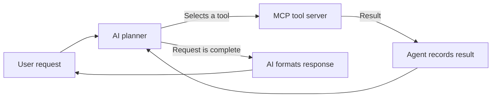

# Multi-Step AI Agent with MCP

A small command-line AI agent that can complete a request by choosing and using multiple tools. For example, one request can ask for the current time and a secure password; the agent can call the time tool, then the password tool, and combine both results into one reply.

This project demonstrates a simple **plan, act, observe, respond** loop, with tools exposed through the Model Context Protocol (MCP).

## What it can do

The included MCP server provides three tools:

- Get the current local system date and time.
- Roll a six-sided die.
- Generate a 12-character password using Python's `secrets` module.

The AI planner selects one tool at a time and can use several tools to satisfy a request. The current agent allows up to five tool actions for each request.

## How it works



For example, for **"Give me the current time and a secure password"**, the planner can call `get_current_time`, inspect its result, then call `generate_password`. Once it decides both parts are covered, the formatter turns the recorded results into one natural-language reply.

## Technology

- **Python 3.12 or newer** runs the application.
- **Groq** provides the language model used to select actions and write the final response.
- **FastMCP** exposes the local tools through MCP; the MCP client discovers and calls them.
- **python-dotenv** loads configuration from a local `.env` file.
- **uv** is used to manage the project dependencies (`uv.lock` is included).

## Run locally

1. Install Python 3.12+ and [uv](https://docs.astral.sh/uv/).
2. From the project directory, install the dependencies:

   ```bash
   uv sync
   ```

3. Create a `.env` file in the project root with these settings:

   ```dotenv
   GROQ_API_KEY=your_groq_api_key
   GROQ_MODEL_NAME=your_groq_model_name
   ```

   Replace the placeholder values with your own Groq credentials and chosen model. Keep `.env` private; it is excluded from Git by `.gitignore`. Never commit real credentials.

4. Start the agent:

   ```bash
   uv run python main.py
   ```

5. Type a request, such as `Give me the current time and a secure password`. Enter `exit`, `bye`, or `quit` to close the program.

## Project layout

```text
main.py                 Command-line input loop
agent/
  loop.py               Coordinates planning, tool calls, and results
  planner.py            Asks Groq which action to take next
  formatter.py          Turns the collected results into a reply
  state.py              Tracks the request, actions, observations, and step limit
  executor.py           Runs the selected MCP tool
  mcp_client.py         Connects to the tool server and discovers/calls tools
  mcp_server.py         Defines the time, dice, and password tools
```

## Current scope

This is a learning example with a small set of local tools. The planner can use up to five actions per request, and the current planning instructions do not allow repeating the same tool within one request.
